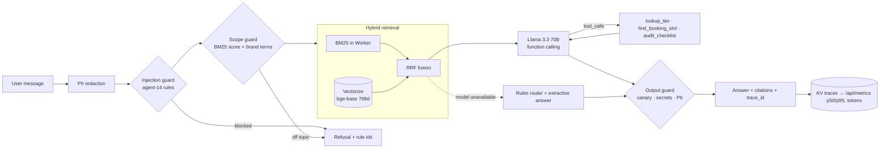

# braylo-si-rag

**The Braylo SI assistant: a production-shaped RAG agent over a real small business's knowledge.** It answers questions about Braylo SI's offers, prices, free audit and booking, with cited sources, function-calling tools, guardrails, evals and tracing. It runs on Cloudflare Workers on the free tier. It is the flagship of the portfolio and the precursor to `braylo.si`. Its knowledge base is the public website only.

**Live demo:** https://braylo-si-rag.braylo777.workers.dev

## What it is
Most "RAG chatbot" demos embed a PDF and call an LLM. This one is built the way a real business assistant has to be:
- **Public knowledge only.** The 5 public pages of the Braylo SI site (home in English and Spanish, booking, terms, privacy), taken from the latest preview build (v22y), are chunked into 68 heading-aware chunks. The business street address is replaced with a pointer to the live page. A test checks that every chunk comes from those 5 pages and that no internal or client text appears.
- **Hybrid retrieval.** BM25 runs inside the Worker. `bge-base-en-v1.5` embeddings live in Vectorize. The two rankings are fused with reciprocal rank fusion (RRF, k=60). If the vector side fails (quota, missing binding), retrieval falls back to BM25 and the response says so.
- **Agentic tool use.** Three function-calling tools with JSON schemas: `lookup_tier` (price and inclusions from the site's ladder), `find_booking_slot` (returns the site's `/book` link, **never creates a booking**), and `audit_checklist` (the free audit checklist, plus leak math computed only from numbers the owner gives; unknowns stay "not checked").
- **Guardrails** (reused from [agent-14](https://github.com/braylo777/agent-14-guardrails-redteam)): PII redaction before logging or the model, a prompt-injection input guard, an off-topic scope guard, and an output guard with a planted canary.
- **Evals** (harness from [agent-11](https://github.com/braylo777/agent-11-rag-eval-harness)): precision@k, recall@k, hit rate and MRR on 24 labelled queries with a dev/test split, plus guard, tool-routing and answer metrics.
- **Observability** (from [agent-13](https://github.com/braylo777/agent-13-serving-observability)): every request gets a trace ID and per-step spans, token counts and a cost estimate. Traces are stored in KV, and `/api/metrics` reports p50/p95 per route.

## Why
A small business owner's questions are narrow: what does it cost, what do I get, can I book, is my data safe. Wrong answers cost money or trust, so the assistant must cite, must refuse anything off scope, must never take actions on its own (it links to booking, it doesn't book), and must be measurable before it ships. That is the gap between a demo and something you can put on a business's site.

## Architecture


## Eval results
All numbers are measured by `node evals/run.mjs` (no model calls) and recorded in [`evals/results.json`](evals/results.json). Run on Oct 27, 2026.

**Labels.** A chunk counts as relevant if it contains every gold phrase for the query (`evals/queries.json`). Labels are computed, not hand-picked, so they are reproducible. Queries have 1 to 9 relevant chunks (mean 2.5). `dev` was used to set the scope threshold; `test` was not used for tuning.

**Retrieval, BM25:**

| Split | precision@1 | precision@3 | recall@3 | recall@5 | hit@5 | MRR |
|---|---|---|---|---|---|---|
| all (24) | 0.625 | 0.444 | 0.645 | 0.81 | 0.917 | 0.726 |
| dev (12) | 0.75 | 0.556 | 0.791 | 0.849 | 1.0 | 0.847 |
| test (12) | 0.50 | 0.333 | 0.50 | 0.771 | 0.833 | 0.605 |

Vector (bge-base) and hybrid RRF retrieval: **not yet run** (Workers AI daily quota).

**Guards and tools:**

| Check | Result | Notes |
|---|---|---|
| Injection guard, attacks blocked | 29/30 | agent-14 red-team set; the rules were tuned on it, so this is optimistic |
| Injection guard, false positives | 0/10 benign + 0/24 Braylo queries | |
| Scope guard, held-out test | 0.842 accuracy (7/7 off-topic blocked, 3/12 on-topic wrongly blocked) | dev: 0.941. A smaller corpus means lower BM25 scores, so more real questions fall under the threshold |
| PII redaction | 6/6 cases | email, phone, SSN, card |
| Tool routing, rules path | 12/12 | small set I wrote; LLM function-calling accuracy not yet run |
| Extractive fallback, answer contains gold phrase | 0.417 | the no-model fallback is weak; citation overlap 0.777. LLM answers not yet run |

**Latency** (box CPU, extractive path, not edge latency): whole pipeline p50 0.41 ms, p95 0.83 ms; retrieval p50 0.10 ms. Live Workers latency and token counts with the model: **not yet run**.

**Not yet run** (Workers AI free daily quota exhausted until about 7 PM CT Oct 28, 2026): vector and hybrid retrieval metrics, LLM function-calling accuracy, LLM answer faithfulness (agent-11 judge), live latency p50/p95 and token counts.

## How it was built
- `scripts/ingest.mjs`: `sources/` → heading-aware chunks (≤700 chars, one-line overlap) → `src/kb.js`.
- `src/retrieve.js`: BM25 + Vectorize, RRF fusion, BM25 fallback.
- `src/tools.js`: tool implementations, JSON schemas, and the rules router used when the model is down.
- `src/agent.js`: the pipeline, each step a traced span.
- `src/guards.js`, `src/obs.js`, `src/metrics.js`, `src/bm25.js`: reused from agents 14, 13 and 11.
- `scripts/index-vectors.mjs`: embeds and upserts the chunks into Vectorize (run once, after the quota reset).
- No runtime dependencies. Tests use Node's built-in runner.

## How it ships
```bash
npm test                 # 24 tests, no network
npm run eval             # writes evals/results.json
npm run ingest           # after editing sources/
npm run index-vectors    # needs CLOUDFLARE_ACCOUNT_ID + CLOUDFLARE_API_TOKEN in env
npx wrangler deploy      # or: node build.mjs, then upload dist/worker.js
```
Free tier only: Workers, Workers AI, Vectorize, KV and the rate-limit binding (5 requests per minute per IP). The rollback point is the git tag `v0-rollback`.

## API
`POST /api/chat {message}` · `GET /api/search?q=` · `POST /api/tool {name,args}` · `GET /api/tools` · `GET /api/metrics` · `GET /api/eval` · `GET /api/health`

## Limits
- The knowledge base is a snapshot of the preview site; rerun `npm run ingest` after site changes.
- The KV trace index is optimistic and can drop a few IDs under concurrent writes.
- The scope guard is lexical, so it misses some paraphrased off-topic asks and blocks some real questions (3/12 on test).

MIT licensed.
